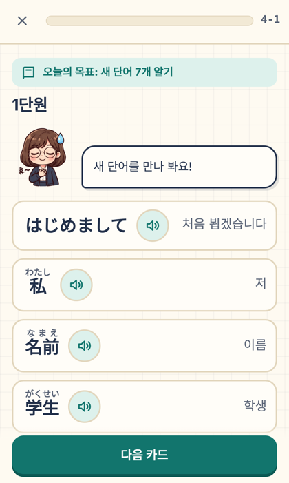

# 사나다 일본어 v0.1.0


한국어를 쓰는 일본어 입문자가 휴대폰·아이패드 브라우저에서 하루 5~10분, **카드만 눌러서** 가나와 기초 단어를 익히는 듀오링고식 학습 웹앱이에요. 타이핑은 없고, 🔊 단추로 기기 음성 발음을 들을 수 있어요.

선생님은 **사나다 유키**(30세)예요. 전국시대 사나다 가문의 후예이고 오사카 출신이에요. 도쿄대에서 국어학·동양사학 박사를, 한국외대에서 한국어교육 박사를 받았고 TOPIK 6급이 있어요. 평소엔 상냥한 표준어를 쓰지만, 틀리면 가끔 오사카 사투리가 튀어나와요(「ちゃうちゃう!」).

- 내용: 히라가나·가타카나(각 69자) + 1~24과 주제 단어 309개 · 26장 · 레슨 90개(장 평가 26개 포함)
- 문제 5종: 일→한 뜻 고르기, 한→일 고르기, 가나 카드 순서 맞추기, 예문 빈칸(문맥이 필요한 단어 124개, 일본어 예문 + 한국어 뜻 힌트), (가나 장) 글자↔소리 고르기
- 한자에는 후리가나가 붙고, 로마자는 쓰지 않아요
- 게임 장치: XP, 하루 목표와 연속 기록, 일일 퀘스트, 배지 11개, 축제 의상 보관함(지역 축제 의상 15벌, 30일 보상 아오모리 네부타)
- **유키의 오사카 다코야키 가게**: 히라가나·가타카나 평가를 통과하면 홈에 열리는 게임. 하루 손님 6명(최대 8명)을 인사·주문 카드로 맞이하고, 번 돈으로 메뉴·철판·장식을 들이고, 장사한 날이 쌓이면 「가게 일기」 이야기 컷이 풀려요. 손님 말은 끝낸 장의 말로만 나오고, 아직 배우지 않은 말은 한국어 힌트가 붙어요. 하루를 마치면 XP +10(하루 두 번까지)
- 서버 없음: 진도는 기기 안(`localStorage`, 키 `sanada-japanese.*`)에 저장, 오프라인에서도 동작
- 기기: 아이폰, 아이패드(폭 700px 이상이면 같은 화면을 1.3배로)

> 바탕은 [해치와 한국어](https://github.com/Fullcharge13/Learning-Korean) v0.4.0(그 바탕은 [리아와 파이썬](https://github.com/Fullcharge13/Learning-Python))이에요. 같은 github.io 주소에 올라가도 세 앱의 저장과 오프라인 저장본이 서로 섞이지 않아요.

**▶ [앱 바로 열기](https://fullcharge13.github.io/Learning-Japanese/)**

아이폰·아이패드는 사파리로 연 뒤 공유 → 「홈 화면에 추가」하면 앱처럼 쓰고 오프라인에서도 돼요.



## 실행 방법

처음 한 번: `npm install`, `pip install -r requirements-dev.txt`

| 하고 싶은 일 | 명령 |
|---|---|
| 개발하면서 열어 보기 | `python3 tools/dev.py` → `http://127.0.0.1:8765/dev/` |
| 배포 파일 만들기 | `python3 build.py` → `dist/` 폴더를 그대로 웹에 올림 |
| 자동 배포 | `main`에 올리면 GitHub Actions가 시험·빌드 후 GitHub Pages에 배포(`.github/workflows/deploy.yml`). 처음 한 번 Settings → Pages → Source를 「GitHub Actions」로 |
| 단어 표에서 레슨 다시 만들기 | `python3 tools/make_lessons.py` (`data/words.csv`를 고친 뒤) |
| 읽기 대조표 다시 만들기 | `pip download --no-deps jamdict-data`로 받은 `jamdict.db`로 `python3 tools/jmdict_subset.py jamdict.db` |
| 그림 시트에서 그림 다시 자르기 | `python3 tools/cut_sheets.py` |

### 단어 표 쓰는 법 (`data/words.csv`)

`jp` 칸의 한자 뒤에 `{읽기}`를 붙이면 후리가나가 돼요: `学生{がくせい}`, `行{い}きます`, `お土産{みやげ}`. 레슨에서 빼려면 `status`를 `hold`로 바꾸고 레슨을 다시 만들어요. 뜻은 달라도 헷갈리는 짝은 `twin` 칸에 같은 이름을 적으면 서로 오답 보기로 나오지 않아요.

### 예문 표 쓰는 법 (`data/examples.csv`)

`sentence_jp`의 빈칸은 `[[…]]`로 감싸고, 안은 그 단어의 `jp`와 똑같이 써요: `駅{えき}に[[行{い}きます]]。` `ko`는 문제 아래 뜻 힌트예요. 빈칸에 넣어도 말이 되는 다른 단어는 `avoid`에 `|`로 적으면 오답 보기에서 빠져요. 문제가 보이는 예문은 `status`를 `hold`로 바꾸고 레슨을 다시 만들어요.

## 시험

| 명령 | 확인하는 것 |
|---|---|
| `npm test` | 저장·연속 기록·XP·퀘스트·배지·상점·레슨 흐름·대사, 후리가나·발음, 화면 글자에 중국어가 남지 않음, 저장 키가 이 앱 것인지 |
| `python3 -m pytest tests -q` | 레슨 생성 규칙(가나 카드 자르기, 정답이 둘로 보이는 보기 막기, 단어 표 오류), 단어 표 읽기가 JMdict와 맞는지 |
| `python3 tests/content.py` | 레슨 90개 점검: 보기 4개·중복 없음, 정답이 둘로 보이는 보기 없음(헷갈리는 짝은 단어 표 `twin` 칸), 모든 단어가 한 번 이상 출제 |
| `python3 tests/build_test.py` | 배포 파일: 한 장 HTML, 크기, 오프라인, 장 파일 따로 받기, 출처 표시 |
| `python3 tests/flow.py` | 아이폰 3종·아이패드 세로/가로 화면 순회: 넘침·터치 크기·입력창 0개·후리가나·🔊·예문 빈칸·해치/리아 저장과 공존, 다코야키 가게(잠김/열림·하루 장사·이어 하기·업그레이드) |

실제 아이폰·아이패드 사파리에서 볼 것은 `docs/device-checklist.md`에 있어요.

## 폴더 구조

```
src/                화면·규칙 코드, src/img/ 유키·축제 의상·가게 그림(PNG)
data/words.csv      단어 표(가나 + 1~24과)
data/lessons/       1~26장 레슨 표(자동 생성)
data/items.js       축제 의상 표 (data/old-items.js: 옛 물건 값, 돌려주기용)
vendor/jmdict/      읽기 대조표(JMdict 부분집합)
tools/              레슨 생성, 읽기 대조, 그림 자르기, 개발 서버, 아이콘
docs/superpowers/   설계서와 작업 계획
docs/img/ref/       유키·축제 의상·가게 참고 그림 시트(사용자 제공)
docs/review/        단어 뜻 교차 검토 기록
```

## 출처와 라이선스

- **단어**: 이 앱을 위해 새로 쓴 단어 표(`data/words.csv`)와 생성물은 **CC BY-SA 4.0**(`data/LICENSE-data.md`).
- **읽기 대조**: [JMdict](https://www.edrdg.org/jmdict/j_jmdict.html)(EDRDG, CC BY-SA 4.0). 사전 뜻은 쓰지 않고 읽기 확인에만 써요(`vendor/jmdict/`).
- **진도 참고**: NHK WORLD-JAPAN 「일본말 첫걸음」 1~24과의 **순서와 주제만** 참고했어요. 교재의 단어 목록·대화·예문·제목은 옮기지 않았어요. 이 앱은 NHK와 관련이 없어요.
- **코드**: MIT (`LICENSE`).
- **유키·축제 의상 그림**: 사용자 제공 그림 시트(`docs/img/ref/`)를 잘라 썼어요(`tools/cut_sheets.py`).
- **가게 그림**(흐름·이야기 컷, 손님 15명): 사용자 제공 그림 시트(`docs/img/ref/shop-*-sheet.png`)를 잘라 썼어요(가로 1024px 시트라 컷이 작아요).

## 알려진 한계

- 단어 뜻·한국어 설명·예문은 Claude가 쓰고 별도 검토 에이전트가 교차 검토한 것이라(`docs/review/`, 예문은 일본어·한국어 두 관점), **원어민 검수 전**이에요. 읽기는 JMdict와 기계 대조했어요.
- 한글 소리 표기(「つ」=「츠」 등)는 근사치예요. 정확한 소리는 🔊로 들어 주세요.
- 🔊는 기기에 들어 있는 일본어 음성을 써서 기기마다 목소리가 달라요. 일본어 음성이 없는 기기에서는 다른 언어 음성으로 읽을 수 있어요.
- 동사는 「~ます」꼴 그대로 외워요(활용·문법 설명 화면은 아직 없음).
- 화면 시험은 Chromium으로 아이폰·아이패드 크기를 흉내 낸 것이라, 실제 사파리에서 다를 수 있어요.
